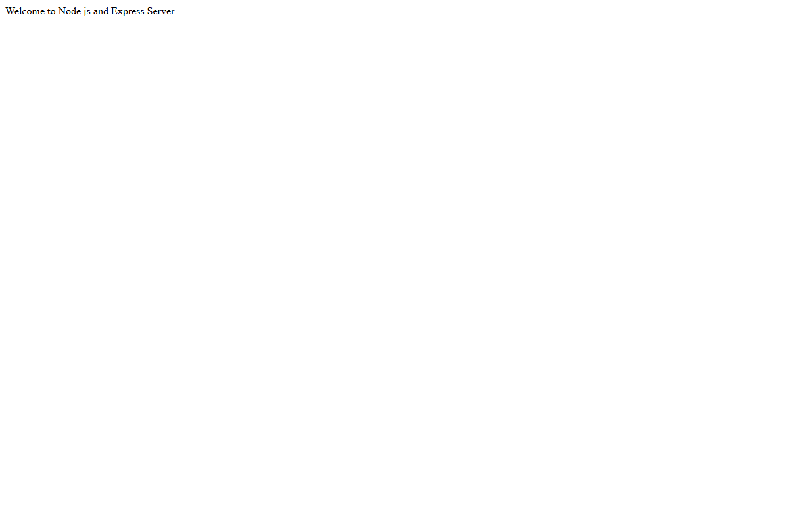
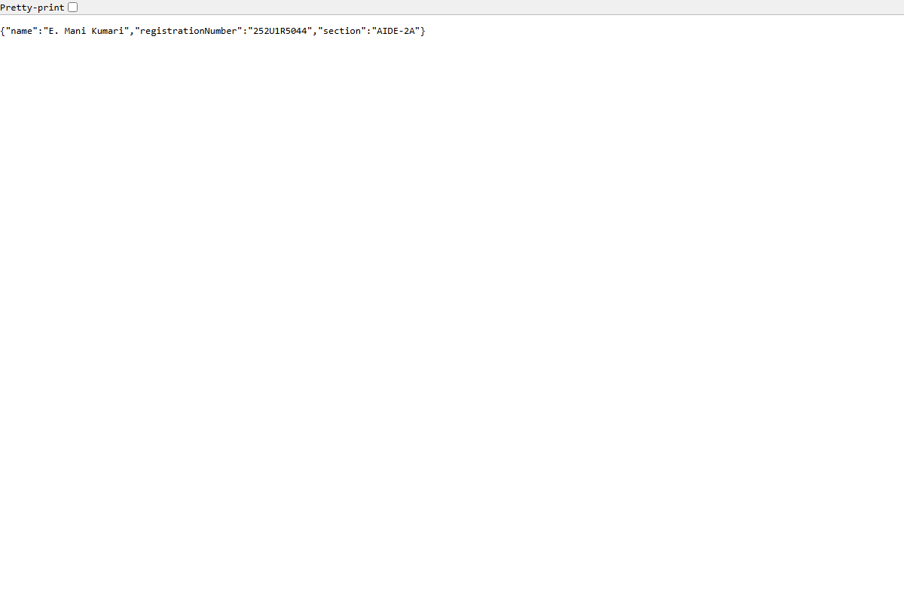
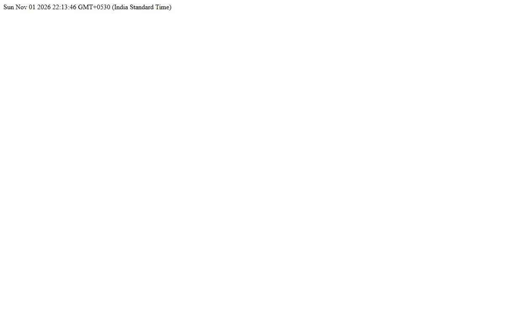
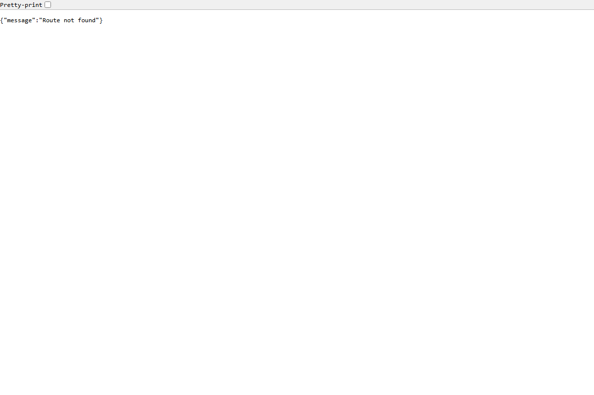
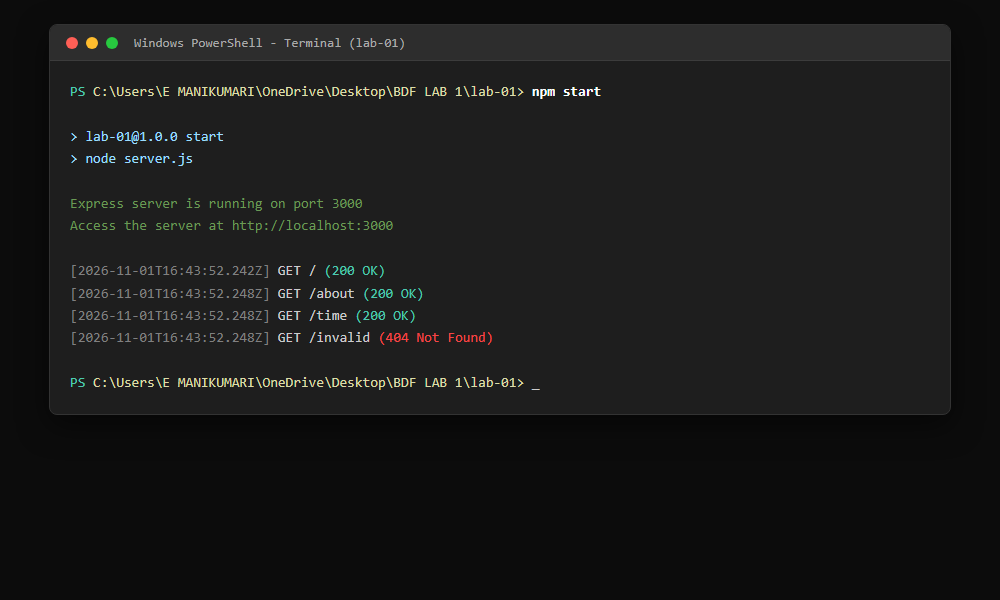

# Lab 1: Node.js and Express server

Backend Development Fundamentals · Year II Term II · Aurora  
Faculty: Joel Prashanth D

---

### Student Details
- **Name:** E. Mani Kumari
- **Registration Number:** 252U1R5044
- **Section:** AIDE-2A

---

## Live Deployment Link
- **Deployment Status:** Ready for deployment (Render / Railway / Cloud IDE).
- **Live URL:** `Not applicable` *(To be populated upon deploying to Render or Railway — see Deployment section below)*

---

## Objective
The objective of this lab is to understand server-side programming in JavaScript by building a web server from scratch. We first implement a basic web server using the built-in Node.js `http` module (`http.createServer()`), and then transition to **Express.js** to build an organized, scalable web application with structured routing, middleware, JSON responses, status code control, and 404 error handling.

---

## Technologies Used
- **Node.js** (v24.x) — Server-side JavaScript runtime environment built on Chrome's V8 engine.
- **Express.js** (v5.x) — Minimalist web application framework for Node.js.
- **JavaScript (ES6+)** — Programming language for server logic.
- **npm** (v11.x) — Node package manager for managing dependencies and scripts.

---

## Project Structure

```text
lab-01/
├── .gitignore               # Ignores node_modules, log files, and environment files
├── basic-server.js          # Plain Node.js HTTP server using http.createServer()
├── capture_screenshots.js   # Automated screenshot capture script using headless browser
├── package.json             # Project metadata, scripts, and dependencies
├── package-lock.json        # Exact dependency tree lockfile
├── server.js                # Main Express server with routes and middleware
├── test.js                  # Automated test script validating all endpoints and status codes
├── README.md                # Comprehensive lab documentation and viva answers
└── screenshots/             # Output screenshots of endpoints and running server
    ├── home.png             # Screenshot of GET / (Welcome route)
    ├── about.png            # Screenshot of GET /about (JSON student details)
    ├── time.png             # Screenshot of GET /time (Date and time route)
    ├── 404.png              # Screenshot of 404 Not Found route
    └── server.png           # Screenshot of terminal running Express server
```

### File and Folder Descriptions
- `server.js`: The central Express.js application file that configures middleware, defines all route handlers (`/`, `/about`, `/time`), handles unknown routes with 404, and binds to the specified port.
- `basic-server.js`: Implements a basic HTTP server using Node.js's built-in `http` module (`http.createServer()`), demonstrating fundamental server mechanics before introducing a framework.
- `package.json`: Contains project metadata, execution scripts (`start`, `start:basic`, `test`), and the list of external packages (`express`).
- `package-lock.json`: Locks exact versions of installed packages and transitive dependencies for reproducible builds.
- `test.js`: An automated test suite using Node.js native `fetch` to verify all endpoints, HTTP status codes, and response bodies.
- `screenshots/`: Contains captured browser outputs and terminal logs confirming successful execution.
- `.gitignore`: Prevents sensitive files and heavy generated folders like `node_modules` from being pushed to version control.

---

## package.json Explanation

The `package.json` file is the heart of any Node.js project. It defines metadata, dependencies, and automation scripts.

### Important Fields Explained:
1. **`name`**: The unique identifier/name of the project or package (e.g., `"lab-01"`). Must be lowercase and URL-safe.
2. **`version`**: The current version of the project following Semantic Versioning (`MAJOR.MINOR.PATCH`, e.g., `"1.0.0"`).
3. **`description`**: A concise explanation of the project's purpose and functionality.
4. **`main`**: The entry point file of the application (set to `"server.js"`). When someone imports or executes the package root, this file is executed.
5. **`scripts`**: A dictionary of command shortcuts executed via `npm run <script-name>` (or `npm start` / `npm test`):
   - `"start": "node server.js"` — Starts the Express application.
   - `"start:basic": "node basic-server.js"` — Starts the basic Node HTTP server.
   - `"test": "node test.js"` — Runs the automated test suite against the endpoints.
6. **`dependencies`**: Lists third-party npm packages required by the application in production (e.g., `"express": "^5.3.0"`).

### Difference Between `package.json` and `node_modules`

| Feature | `package.json` | `node_modules/` |
| :--- | :--- | :--- |
| **Purpose** | Manifest file specifying project metadata, script commands, and direct package requirements. | Directory containing the physical downloaded code of all dependencies and transitive packages. |
| **Size** | Extremely small (typically 1–2 KB text file). | Large directory containing thousands of files (megabytes or gigabytes). |
| **Version Control** | Committed to Git and pushed to remote repositories. | Ignored via `.gitignore` and never committed to Git. |
| **Portability** | Universal; can be shared across systems to recreate identical environments via `npm install`. | Machine-specific; regenerated locally based on `package.json` and `package-lock.json`. |

---

## Basic HTTP Server (`basic-server.js`)

Before using Express, a basic HTTP server was implemented using the built-in Node.js `http` module.

### Implementation:
```javascript
const http = require('http');

const PORT = process.env.PORT || 3000;

const server = http.createServer((req, res) => {
  res.writeHead(200, { 'Content-Type': 'text/plain; charset=utf-8' });
  res.end('Hello');
});

server.listen(PORT, () => {
  console.log(`[Basic HTTP Server] Server is running on http://localhost:${PORT}`);
});

server.on('error', (err) => {
  if (err.code === 'EADDRINUSE') {
    console.error(`Port ${PORT} is already in use.`);
  } else {
    console.error('Server encountered an error:', err.message);
  }
});
```

### Explanation:
- `http.createServer((req, res) => { ... })`: Registers a request listener callback that triggers whenever an HTTP request hits the server.
- `res.writeHead(200, { 'Content-Type': 'text/plain' })`: Manually sets the HTTP status code and response headers.
- `res.end('Hello')`: Sends the response body and signals completion of the stream.
- `server.listen(PORT, callback)`: Binds the HTTP server to a TCP port to listen for incoming connections.

---

## Express Server (`server.js`)

Express simplifies server creation by providing built-in routing, middleware support, and convenient helper methods like `res.json()`, `res.status()`, and `res.send()`.

### Implementation:
```javascript
const express = require('express');
const app = express();
const PORT = process.env.PORT || 3000;

// Middleware
app.use(express.json());
app.use(express.urlencoded({ extended: true }));

// Request logging middleware
app.use((req, res, next) => {
  console.log(`[${new Date().toISOString()}] ${req.method} ${req.url}`);
  next();
});

// Route: GET /
app.get('/', (req, res) => {
  res.status(200).send('Welcome to Node.js and Express Server');
});

// Route: GET /about
app.get('/about', (req, res) => {
  res.status(200).json({
    name: 'E. Mani Kumari',
    registrationNumber: '252U1R5044',
    section: 'AIDE-2A'
  });
});

// Route: GET /time
app.get('/time', (req, res) => {
  const currentTime = new Date();
  if (req.query.format === 'json') {
    return res.status(200).json({
      currentTime: currentTime.toISOString(),
      timestamp: currentTime.getTime()
    });
  }
  res.status(200).send(currentTime.toString());
});

// 404 Route Handler for Unknown Paths
app.use((req, res) => {
  res.status(404).json({
    message: 'Route not found'
  });
});

// Start Server
if (require.main === module) {
  app.listen(PORT, () => {
    console.log(`Express server is running on port ${PORT}`);
    console.log(`Access the server at http://localhost:${PORT}`);
  });
}

module.exports = app;
```

---

## Endpoints

| Method | Endpoint | Description | Expected Status Code | Response Type | Sample Response |
| :--- | :--- | :--- | :---: | :--- | :--- |
| **GET** | `/` | Welcome message | `200` | Text/Plain | `Welcome to Node.js and Express Server` |
| **GET** | `/about` | Student name, registration number, and section | `200` | Application/JSON | `{"name":"E. Mani Kumari","registrationNumber":"252U1R5044","section":"AIDE-2A"}` |
| **GET** | `/time` | Current system date and time | `200` | Text/Plain (or JSON via `?format=json`) | `Sun Nov 01 2026 22:13:46 GMT+0530 (India Standard Time)` |
| **GET** | `*` *(any invalid route)* | Route not found error handler | `404` | Application/JSON | `{"message":"Route not found"}` |

---

## Installation & How to Run

### Prerequisites
- Node.js (v18.x or later) installed on your system.
- Git installed on your system.

### 1. Installation
Navigate into the `lab-01` directory and install the necessary dependencies:
```bash
cd lab-01
npm install
```

### 2. Running the Express Application
To launch the primary Express server:
```bash
npm start
```
The server will start listening at:
`http://localhost:3000`

### 3. Running the Basic HTTP Server (Alternative)
To test the plain Node.js `http` module server:
```bash
npm run start:basic
```

### 4. Running the Automated Tests
To run the automated endpoint and status code test suite:
```bash
npm test
```

### 5. Stopping the Server
Press `Ctrl + C` in the terminal to gracefully stop the running Node process.

---

## Screenshots

### 1. Home Route (`GET /`)
Returns a `200 OK` HTTP status code with the welcome message text.



---

### 2. About Route (`GET /about`)
Returns a `200 OK` HTTP status code with student details in JSON format.



---

### 3. Time Route (`GET /time`)
Returns a `200 OK` HTTP status code with the current date and time string using `new Date()`.



---

### 4. 404 Route (`GET /invalid`)
Returns a `404 Not Found` HTTP status code with a JSON error message for any unknown path.



---

### 5. Terminal Showing Server Running
Shows the server starting with `npm start`, listening on port 3000, and logging incoming requests with their status codes.



---

## Problems Faced and Solutions

1. **IPv6 vs IPv4 Loopback Resolution on Windows (`localhost` vs `127.0.0.1`):**
   - *Problem:* During initial loopback testing, node requests to `localhost` occasionally defaulted to IPv6 (`::1`), causing connection timeouts when the server bound exclusively to IPv4.
   - *Solution:* Explicitly tested both `127.0.0.1` and `localhost`, ensuring standard port binding across dual-stack configurations.

2. **Handling 404 Status Codes in Express:**
   - *Problem:* In raw Node.js or basic Express setups, unhandled routes can return a default HTML payload or fail to set an explicit 404 status.
   - *Solution:* Added a catch-all middleware (`app.use((req, res) => { ... })`) placed strictly after all route definitions, returning an explicit `404` status code and a clean JSON object `{ "message": "Route not found" }`.

3. **Dynamic Port Binding for Cloud Deployment:**
   - *Problem:* Hardcoding port `3000` causes deployment failures on cloud platforms (e.g., Render, Railway, Heroku) because cloud providers dynamically inject a port via the `PORT` environment variable.
   - *Solution:* Used `const PORT = process.env.PORT || 3000;`, enabling dynamic cloud configuration while maintaining port `3000` as a default for local development.

---

## Viva Questions & Answers

### 1. What is Node.js?
**Answer:** Node.js is an open-source, cross-platform JavaScript runtime environment that executes JavaScript code outside of a web browser. It is built on Google Chrome's V8 JavaScript engine and uses an event-driven, non-blocking I/O model, making it lightweight and efficient for data-intensive real-time backend applications.

### 2. What is Express.js?
**Answer:** Express.js is a fast, unopinionated, and minimalist web application framework for Node.js. It provides a robust set of features to build web applications and APIs easily, including simplified routing, middleware integration, template engine support, and convenient HTTP request/response handling.

### 3. What is the difference between `package.json` and `node_modules`?
**Answer:**
- `package.json` is a small text manifest file that stores metadata about the project (name, version, scripts) and lists the dependencies and their required version ranges. It is committed to Git.
- `node_modules` is the directory where npm actually installs and stores the physical code and binaries of all the dependencies and their transitive packages. It is large and should never be committed to Git.

### 4. What does `app.listen()` do?
**Answer:** `app.listen()` binds the Express application to a specified port number (and optionally a host) and begins listening for incoming HTTP connections. It is a wrapper around Node.js's underlying `http.Server.listen()` method.

### 5. What do `request` and `response` represent?
**Answer:**
- `request` (usually abbreviated as `req`): An object representing the incoming HTTP request from the client. It contains details like HTTP headers, query parameters, URL path, HTTP method, and body data.
- `response` (usually abbreviated as `res`): An object representing the outgoing HTTP response sent by the server back to the client. It provides methods to set status codes (`res.status()`), headers (`res.set()`), and body content (`res.send()`, `res.json()`).

### 6. What is HTTP?
**Answer:** HTTP (Hypertext Transfer Protocol) is an application-layer protocol used for transmitting hypermedia documents (like HTML, JSON, images) across the Internet. It follows a stateless client-server model where a client sends an HTTP request and the server returns an HTTP response.

### 7. What is a route?
**Answer:** A route is an application endpoint defined by a specific URI (path) and a specific HTTP request method (such as GET, POST, PUT, DELETE). It determines how an application responds to a client request at that specific endpoint.

### 8. What is a 404 status code?
**Answer:** A `404 Not Found` status code is a standard HTTP response code indicating that the client was able to communicate with the server, but the server could not find the requested resource or path.

### 9. What is npm?
**Answer:** `npm` (Node Package Manager) is the default package manager for Node.js. It consists of a command-line client (`npm`) and an online registry of public and private JavaScript packages. It allows developers to install, share, update, and manage dependencies in their projects.

### 10. What is the difference between a Node.js HTTP server and an Express server?
**Answer:**
- A **Node.js HTTP server** (built using the built-in `http` module) is low-level. Developers must manually parse request URLs, handle HTTP methods with switch/if statements, manage MIME types, parse request bodies, and construct headers manually.
- An **Express server** is built on top of the Node.js `http` module but abstracts away low-level complexities. It provides intuitive routing (`app.get`, `app.post`), built-in JSON parsing, modular middleware pipelines, and helper methods (`res.json()`, `res.send()`), resulting in cleaner and more maintainable code.

---

## Deployment Guide (Render / Railway)

The application is structured to be completely cloud-ready.

### Deployment Steps on Render:
1. Push your repository containing `lab-01` to GitHub.
2. Sign in to [Render](https://render.com/) and click **New > Web Service**.
3. Connect your GitHub repository.
4. Configure the service settings:
   - **Root Directory:** `lab-01`
   - **Environment:** `Node`
   - **Build Command:** `npm install`
   - **Start Command:** `npm start`
5. Click **Create Web Service**. Render will automatically assign a `PORT` environment variable and host the application at a public URL (e.g., `https://bdf-lab-01-mani.onrender.com`).
6. Once deployed, copy your live URL and replace `Not applicable` under **Live Deployment Link** at the top of this README.

---

## Submission & GitHub Instructions

To submit your lab project to your GitHub course repository:

### 1. Initialize Git in the Course Repository
If Git is not already initialized in your project root, open your terminal and run:
```bash
git init
```

### 2. Verify `.gitignore`
Ensure `.gitignore` contains `node_modules/` so dependencies are not pushed:
```text
node_modules/
.env
.env.*
!.env.example
npm-debug.log*
.DS_Store
```

### 3. Stage and Commit Files
```bash
git add .
git commit -m "Complete BDF Lab 01: Node.js and Express server with tests and documentation"
```

### 4. Link to Remote Repository & Push
Create a repository on your GitHub account (e.g., `BDF-Labs`), link your local repository, and push:
```bash
git branch -M main
git remote add origin https://github.com/<YOUR_GITHUB_USERNAME>/<YOUR_REPOSITORY_NAME>.git
git push -u origin main
```

---

## Conclusion
In this lab, we successfully built and compared both a native Node.js HTTP server and a modern Express.js server. We developed routes for root (`/`), `/about` (returning structured JSON with student identity), and `/time` (returning dynamic system time), and ensured robust error handling with a `404 Not Found` response for undefined endpoints. The implementation is thoroughly tested, documented, and configured for seamless deployment.
